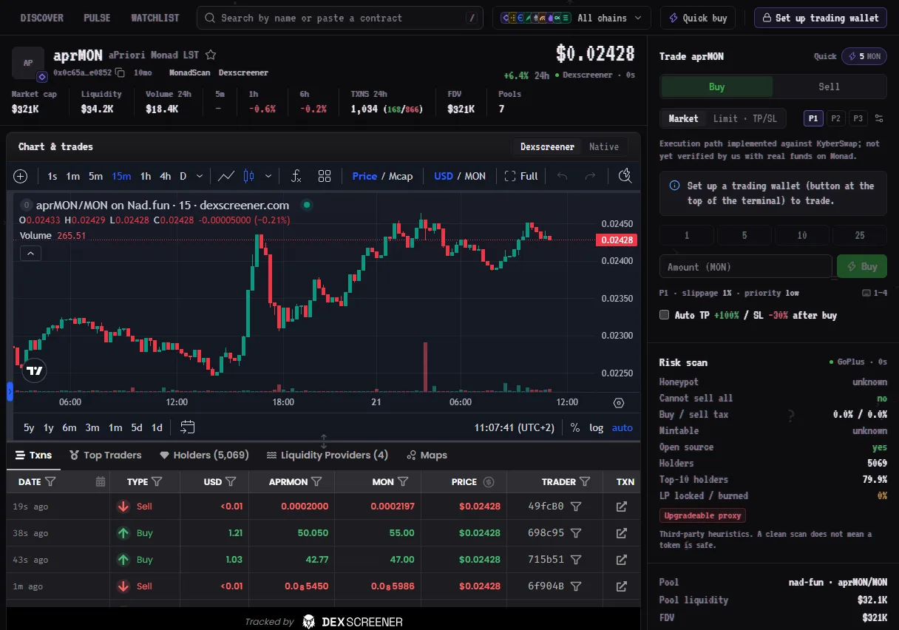
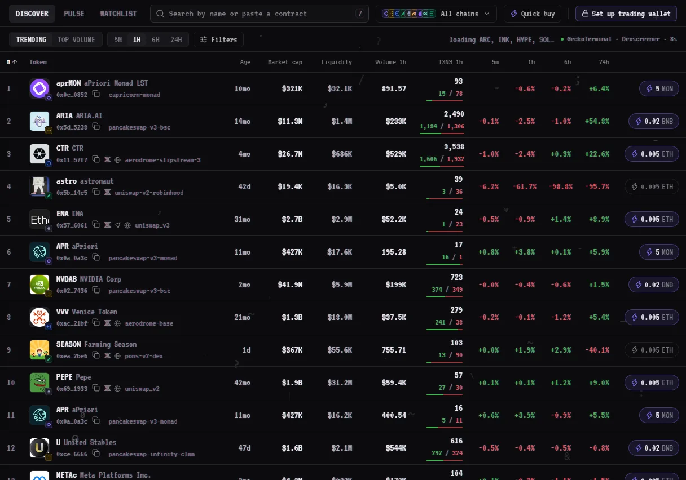
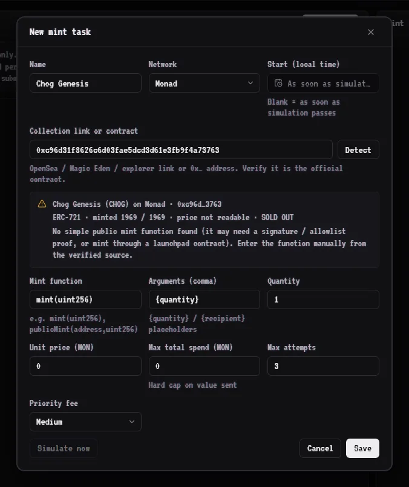
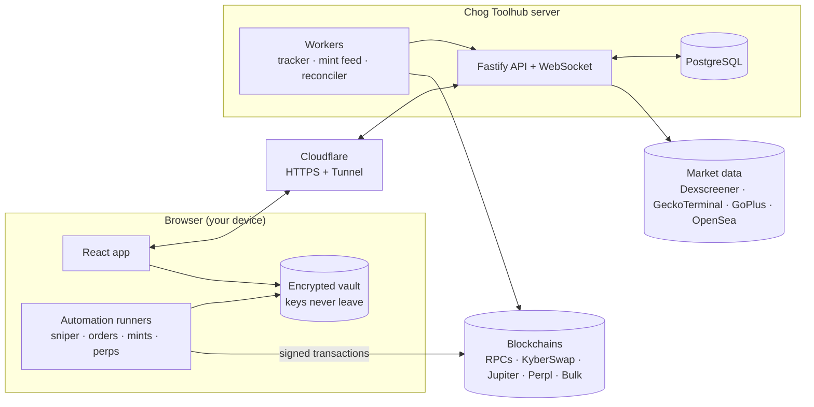

<div align="center">


# Chog Toolhub

**A desktop trading workstation for Chog Genesis holders on Monad.**
Memecoin terminal, launch sniper, wallet tracker with copy trading, NFT mint sniper, perps volume farming
and a PnL portfolio in one place. Keys never leave the browser, and Chog Toolhub charges no trading fee.

[**chogtoolhub.space**](https://chogtoolhub.space) ·
[Product spec](docs/PRODUCT_SPEC.md) · [Architecture](docs/ARCHITECTURE.md) · [Security](docs/SECURITY.md) ·
[Deploy](docs/DEPLOY.md)

[](https://github.com/exsay07/chog-toolhub-hackathon/actions/workflows/ci.yml)




</div>

> [!WARNING]
> Trading and automation can lose money. The execution paths are implemented and tested against live quotes and
> simulations, but **have not yet been verified with real funds** on every network. Keep trading balances small and
> read [docs/SECURITY.md](docs/SECURITY.md) before using real money.

---

## Contents

1. [What it is](#1-what-it-is)
2. [Features](#2-features)
3. [Supported networks](#3-supported-networks)
4. [How it works](#4-how-it-works)
5. [Security model](#5-security-model)
6. [Tech stack](#6-tech-stack)
7. [Repository layout](#7-repository-layout)
8. [Run it locally](#8-run-it-locally)
9. [Configuration](#9-configuration)
10. [Tests and quality checks](#10-tests-and-quality-checks)
11. [Deploy to production](#11-deploy-to-production)
12. [Documentation](#12-documentation)

---

## 1. What it is

Chog Toolhub is a web app for the holders of the **Chog Genesis** NFT collection on Monad. You sign in by
signing a message with the wallet that holds a Chog Genesis: any EVM browser wallet (MetaMask, Rabby, Coinbase,
OKX, Phantom, …) or a phone wallet through WalletConnect. Access is checked on-chain at sign-in and every
few minutes after that, so selling the NFT ends the session.

Inside, the tools fall into four groups, the same groups as in the app's sidebar:

| Group         | Tools                                                    |
| ------------- | -------------------------------------------------------- |
| **Memecoins** | Token Terminal · Token Sniper · Wallet Tracker           |
| **NFT**       | NFT Sniper · Top Collections · Mint Tracker              |
| **Perps**     | Perps Farm (Perpl and Bulk)                              |
| **Account**   | Portfolio (PnL calendar, shareable PnL cards) · Settings |

It is built for desktop browsers. Phones get a short "available on desktop" page.

## 2. Features

### Token Terminal



- **Discover**: trending and top-volume tokens across all chains, with 5m/1h/6h/24h changes, transactions,
  liquidity and market-cap filters, plus a ⚡ one-click buy on every row.
- **Pulse**: three live columns (new pairs, heating up, trending), refreshed every few seconds.
- **Token page**: Dexscreener chart and trades, a stats strip, every pool of the token, and a risk scan (honeypot,
  taxes, mint/freeze authority, holder and creator concentration, locked liquidity).
- **Trade panel**:
  - presets P1/P2/P3, each with its own slippage and priority for buys and sells;
  - four one-click buy amounts per chain and four sell percentages;
  - hotkeys: `1`–`4` buy, `Shift+1`–`4` sell;
  - optional instant trading without the review dialog.
- **Limit · TP/SL**: limit buys, breakout buys, take-profits and stop-losses with expiry. "Auto TP/SL" places both
  after every buy, and when one of them fills, the other is cancelled.
- **Watchlist** and recently opened tokens, synced to your account.

### Token Sniper

- Watches new pools on any supported chain. Filters: liquidity, FDV, pool age, 5-minute buyers and volume, quote
  asset, DEX, name, blacklist.
- **Anti-rug checks** before every auto-buy: honeypot and taxes, mint/freeze authority, hidden owner and owner
  powers, top-10 holder and creator share, locked/burned LP, creator blacklist.
- **Exits run by themselves**:
  - take-profit ladder: sell part of the position at each target;
  - trailing stop, stop-loss and full take-profit;
  - **dev-sell protection**: sell everything when the creator dumps.
- Buy limits per hour, a cap on open positions, and an optional buy from several wallets at once. A Positions tab
  shows live PnL and each position's exit plan.

### Wallet Tracker and copy trading

Follow any wallet on any chain and see its buys and sells live. Copy trading mirrors its buys with your own
amount and limits.

### NFT Sniper, Mint Tracker, Top Collections



- **Paste a link, get a task**: an OpenSea, Magic Eden or explorer link, or a bare address. The app finds the
  chain and reads the contract itself: name, standard, supply, price, per-wallet and per-transaction limits, sale
  state, and the public mint function (proxies included).
- Every detected function is simulated from your wallet before anything is sent. A task can mint from several
  wallets, with a hard spending cap per wallet.
- **Mint Tracker** reads live mints from the chain, flags bot-farmed (SUS) mints and airdrops, and opens a mint task
  in one click. **Top Collections** lists floor, volume and owners per chain (OpenSea).

### Perps Farm

Volume-farming bots for **Perpl** (Monad) and **Bulk** (Solana) that run in the browser tab. You choose the pair,
size, leverage, direction and order types; Limit/Limit uses maker fees. Daily-loss and runtime limits apply. The
bot signs with a trading key that cannot withdraw funds: for Perpl it is enrolled with one wallet signature, for
Bulk it is a Phantom-approved agent.

### Portfolio

Balances, realized PnL from reconciled on-chain fills, a daily PnL calendar, and animated PnL cards with the Chog
mascot. The cards export as PNG or as a video.

### Trading wallet and multi-wallet

- Trading keys are generated **in your browser** and encrypted with your password (PBKDF2 600k → AES-256-GCM).
- Up to **20 extra EVM wallets** live in the same encrypted vault. You can fund them all from the main wallet in
  one step, sweep them back, and pick them per NFT task, per sniper or per trade.

### Experience

- First-login guide with real screenshots.
- CRT/Chog visual identity, a music player and quiet interface sounds.
- Smooth wheel scrolling and an emergency stop that disarms every automation at once.

## 3. Supported networks

| Network         | Trading route | Status                   |
| --------------- | ------------- | ------------------------ |
| Monad           | KyberSwap     | implemented · unverified |
| BNB Smart Chain | KyberSwap     | implemented · unverified |
| Base            | KyberSwap     | implemented · unverified |
| Ethereum        | KyberSwap     | implemented · unverified |
| Arc             | KyberSwap     | implemented · unverified |
| HyperEVM        | KyberSwap     | implemented · unverified |
| Solana          | Jupiter       | implemented · unverified |
| Robinhood Chain | —             | market data only         |
| Ink             | —             | market data only         |

**What the statuses mean:**

- **implemented · unverified**: quotes, simulation and signing are tested live, but the path has not yet been
  exercised with real funds.
- **market data only**: no route is available yet.

[docs/INTEGRATIONS.md](docs/INTEGRATIONS.md) has the full capability matrix and data providers.

## 4. How it works



- **The server** handles sign-in, the NFT gate, account data, shared market-data caching (one upstream request
  serves every viewer), the wallet tracker, the mint feed and transaction reconciliation. It never holds trading
  keys.
- **The browser** holds the keys, builds every trade (quote → risk check → simulation → signature) and runs the
  automations while a tab is open and the vault is unlocked.
- **Production** runs as one Docker Compose stack: app, PostgreSQL, daily backups and a Cloudflare Tunnel. No web
  port is open on the server.

## 5. Security model

| Area         | Controls                                                                                                                                                                    |
| ------------ | --------------------------------------------------------------------------------------------------------------------------------------------------------------------------- |
| **Access**   | SIWE sign-in, on-chain NFT check at login and every 5 minutes, session revoked when the NFT leaves the wallet.                                                              |
| **Sessions** | 256-bit tokens (only hashes stored), HttpOnly + SameSite=Strict cookies, `Origin` allow-list plus a mandatory CSRF header, server-side revocation.                          |
| **Keys**     | Generated and encrypted in the browser. The server only ever sees public addresses. Auto-lock after idle time; export needs the password again.                             |
| **Trades**   | Router allow-list, exact-amount approvals, simulation before signing, duplicate-send guard, per-trade and 24-hour limits, slippage/impact/liquidity limits, emergency stop. |
| **Platform** | Strict CSP, HSTS, rate limits per real client IP, payload limits, no open ports behind the tunnel, fail2ban, automatic security updates.                                    |

Read [docs/SECURITY.md](docs/SECURITY.md) for the threat model, and
[docs/SECURITY_AUDIT.md](docs/SECURITY_AUDIT.md) for audit findings, their fixes and the known residual risks.

## 6. Tech stack

| Layer       | Technology                                                                                                |
| ----------- | --------------------------------------------------------------------------------------------------------- |
| **Web**     | React 19, Vite, Tailwind CSS v4, TanStack Query and Virtual, viem, @solana/web3.js v3, lightweight-charts |
| **API**     | Node.js, Fastify 5, Drizzle ORM, PostgreSQL 17 (embedded PGlite for development and tests), zod, pino     |
| **Shared**  | `@chog/shared`: networks, validation schemas, risk engine, PnL, transaction state machine                 |
| **Quality** | TypeScript strict, ESLint, Prettier, Vitest, Playwright, gitleaks, ShellCheck, autocannon load tests      |
| **Ops**     | Docker, Docker Compose, Cloudflare Tunnel, automated PostgreSQL backups, GitHub Actions CI                |

## 7. Repository layout

```
apps/
  web/          React single-page app (pages, components, trading engine, vault, automation runners)
  server/       Fastify API, database schema + migrations, workers, market-data providers
  agent/        optional local agent for external farming software (loopback only)
packages/
  shared/       code used by web and server: networks, schemas, risk rules, PnL
e2e/            Playwright end-to-end tests
deploy/         production stack: docker-compose, server setup, install / update / restore scripts
docs/           product, architecture, integrations, security, performance, deployment
scripts/        tooling: secret scan, load tests, chunk check, guide screenshots
```

## 8. Run it locally

**Requirements:** Node.js 22.12 or newer, npm 10+, and a desktop browser with an EVM wallet extension.

```bash
npm ci                      # install all workspaces
cp .env.example .env        # optional: defaults work for local development
npm run dev:server          # API on http://127.0.0.1:8787 (embedded database in apps/server/.data)
npm run dev:web             # app on http://localhost:5173
```

Open <http://localhost:5173> and sign in. Without a Chog Genesis NFT, add your wallet to `.env` as
`NFT_GATE_DEV_ALLOWLIST=0xYourAddress`. The header then shows "DEV ACCESS", and the server refuses this setting in
production.

## 9. Configuration

Every variable is listed in [.env.example](.env.example) with an inline description. None is required for local
development. Production requires `NODE_ENV=production`, an `https` `APP_ORIGIN` and a `DATABASE_URL`, and refuses
to start with unsafe settings. The following are optional but recommended:

| Variable                   | Purpose                                                                |
| -------------------------- | ---------------------------------------------------------------------- |
| `RPC_MONAD`, `RPC_BASE`, … | your own RPC endpoints (comma-separated for fallback)                  |
| `COINGECKO_PRO_API_KEY`    | removes the free GeckoTerminal rate limit on charts and lists          |
| `OPENSEA_API_KEY`          | Top Collections. When empty, the server obtains a free-tier key itself |
| `WALLETCONNECT_PROJECT_ID` | phone-wallet sign-in by QR code (free Reown project id)                |

## 10. Tests and quality checks

```bash
npm run lint && npm run format:check && npm run typecheck
npm test                          # unit + integration (OFFLINE=1 skips the live-provider tests)
npx playwright install chromium
npm run test:e2e                  # end-to-end, starts its own servers on separate ports
E2E_PROD=1 npm run test:e2e       # the same suite against the production build
npm run audit:deps && npm run scan:secrets
npm run loadtest                  # load test, results in docs/PERFORMANCE.md
```

The production build fails on its own if two code chunks import each other in a circle
(`scripts/check-chunks.mjs`). CI runs lint, types, tests and secret scanning on every push.

## 11. Deploy to production

One small VPS (Ubuntu 22.04/24.04, 2 vCPU / 4 GB is plenty) plus a free Cloudflare account. Three commands:

```bash
scp deploy/setup-vps.sh root@SERVER:        # 1. from your PC
bash setup-vps.sh                           # 2. on the server as root: hardening, Docker, deploy key
git clone git@github.com:exsay07/chog-toolhub-hackathon.git && cd chog-toolhub && bash deploy/install.sh   # 3. as "chog"
```

After that, two scripts cover day-to-day operation:

- `bash deploy/update.sh` updates the site. It takes a fresh database backup before changing anything.
- `bash deploy/restore.sh` restores the database from a backup.

Backups run daily and can be copied off the server to Cloudflare R2. The full step-by-step guide is in
[docs/DEPLOY.md](docs/DEPLOY.md).

## 12. Documentation

| Document                                              | What is inside                                                    |
| ----------------------------------------------------- | ----------------------------------------------------------------- |
| [PRODUCT_SPEC.md](docs/PRODUCT_SPEC.md)               | features, principles, PnL methodology                             |
| [ARCHITECTURE.md](docs/ARCHITECTURE.md)               | components, data flow, scaling                                    |
| [INTEGRATIONS.md](docs/INTEGRATIONS.md)               | network capability matrix, providers, verification evidence       |
| [SECURITY.md](docs/SECURITY.md)                       | threat model and controls                                         |
| [SECURITY_AUDIT.md](docs/SECURITY_AUDIT.md)           | audit findings, fixes and residual risks                          |
| [PERFORMANCE.md](docs/PERFORMANCE.md)                 | load-test method and results (1000 WebSockets, 300 users)         |
| [DEPLOY.md](docs/DEPLOY.md)                           | production deployment, backups and updates                        |
| [IMPLEMENTATION_PLAN.md](docs/IMPLEMENTATION_PLAN.md) | delivery checklist with acceptance criteria                       |
| [DEVELOPMENT.md](docs/DEVELOPMENT.md)                 | database, build checks, screenshots, demo recording, brand assets |

---

<div align="center">
<sub>Built for the Chog Genesis community on Monad. Proprietary — all rights reserved.</sub>
</div>
